# ROAM 漫游 · 多智能体 AI 旅行规划工作台

ROAM 是面向 **1–7 天国内城市自由行**的 AI 旅行规划应用。输入目的地、日期、人数、预算与偏好，即可获得包含 **景点、三餐、住宿、天气和费用**的逐日方案；还可以继续用自然语言调整某一天、替换地点、锁定已确定的安排，并保存、撤销或导出行程。

项目基于 **LangChain + Tool Calling** 组织多智能体协作，接入 **高德地图与和风天气**，结合地点候选、交通耗时、常规营业时间与预算规则，让旅行方案既便于阅读，也便于继续修改和核对。

**个性化规划 · 真实地点资料 · 对话调整 · 候选替换 · 地点锁定 · 预算估算 · SSE 进度 · 行程备份**

[核心功能](#核心功能) · [使用流程](#使用流程) · [功能演示](#功能演示) · [技术栈与架构](#技术栈与架构) · [快速开始](#快速开始)

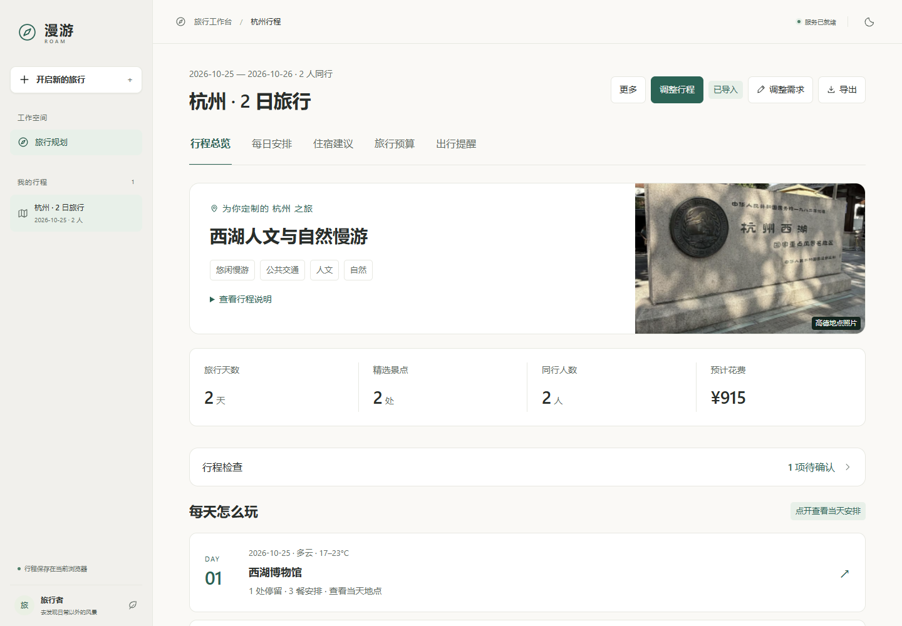

## 核心功能

| 功能 | 具体可以做什么 |
| --- | --- |
| **个性化旅行需求** | 设置城市、日期、同行人数、预算范围、旅行节奏、住宿标准与出行方式；组合人文、自然、美食、艺术、购物、夜生活、亲子偏好，补充想做的事与需要避开的安排 |
| **多智能体协作规划** | 景点、天气、酒店研究 Agent 并行获取资料，规划 Agent 先分配每天景点与住宿，再细化逐日活动与餐饮安排 |
| **真实地点资料** | 优先关联高德 POI，展示地点照片、具体地址和坐标；提供高德地图入口，身份不明确或资料缺失时保留提示，不把模糊结果当作精确地点 |
| **逐日行程与三餐** | 按日期、时间查看景点、餐饮和住宿，结合交通耗时、游玩时长、正常用餐窗口及可解析的营业时段核对排程 |
| **天气与出行提醒** | 展示可查询日期的天气与出行建议；远期天气保持未知，提示临近出发再次确认，不用生成温度填补空缺 |
| **自然语言问答与调整** | 询问当前费用和安排，或提出“第二天轻松一点”“只保留一个景点”等要求；识别修改范围并展示变化，范围不清楚时提示补充 |
| **景点、餐厅与酒店替换** | 查询符合要求的其他候选，比较名称、地址和参考信息后确认替换；酒店替换会同步使用它的住宿日期，并重新核算相关安排 |
| **地点锁定与撤销** | 锁定景点、餐厅或酒店，后续调整保留地点及所在日期；支持撤销最近 5 次修改，恢复对应行程、需求与费用 |
| **旅行预算管理** | 查看总费用、人均费用，以及住宿、门票、餐饮、交通和弹性预算的构成；随行程调整重新汇总，超出预算时给出提示 |
| **行程检查与来源说明** | 区分已发现的硬冲突与资料待确认项，展示坐标、具体餐厅和开放资料等检查结果；保留数据来源与查询状态 |
| **后台规划与任务恢复** | 通过 SSE 展示规划阶段；幂等提交、事件重放和任务快照支持页面刷新与短暂断线后取回同一任务 |
| **历史、备份与跨屏查看** | 在当前浏览器保存旅行历史，导出 Markdown，备份或导入 JSON；支持桌面、移动端与浅色／深色主题，无 Key 时可查看只读历史示例 |

## 使用流程

1. **填写需求**：选择目的地与日期，设置人数、预算和旅行偏好。
2. **生成方案**：后台并行查询景点、天气和酒店，再编排行程，核对交通、开放规则和费用；页面持续显示当前阶段。
3. **查看详情**：从总览进入每日安排、住宿、预算或出行提醒；查看地点照片与地址，打开高德地图定位。
4. **继续调整**：先锁定需要保留的地点，再通过对话修改某天，或从候选中更换景点、餐厅和酒店；不满意时撤销。
5. **保存出行**：从历史重新打开行程，导出便于阅读的 Markdown，或用 JSON 备份完整上下文后重新导入。

## 功能演示

以下截图来自实际运行的应用，结果页以历史生成的杭州两日行程展示。照片来自地点资料；天气、营业信息为查询时记录，费用属于规划估算。点击图片可查看大图。

### 1. 旅行需求与快速开始

首页集中填写目的地和日期，选择兴趣标签，也可以从杭州、成都、北京的旅行灵感开始。无需配置 Key 即可打开历史示例，先了解完整结果页面。

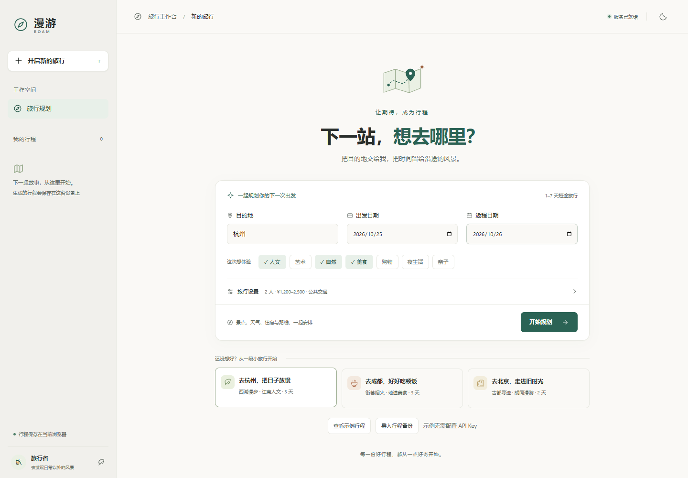

### 2. 预算、节奏与个性化约束

展开旅行设置，指定同行人数、预算上下限、旅行节奏、酒店标准和出行方式；公共交通可选择少步行、地铁优先等偏好。额外需求与忌讳会参与候选筛选和规划，例如保留完整游玩时间、避免高强度爬山。

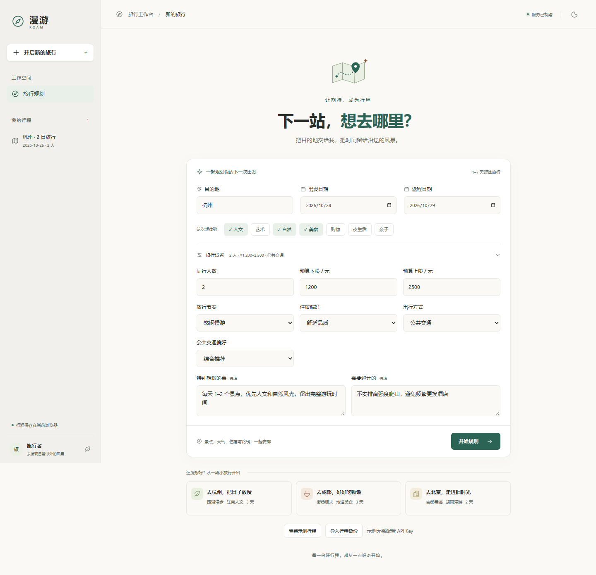

### 3. 逐日安排与地点卡片

每天单独查看，沿时间顺序浏览景点、三餐与当天住宿。地点卡片展示代表图片、具体地址和高德入口，便于查位置；页面集中展示活动信息，后台仍保留交通耗时用于排程核对。

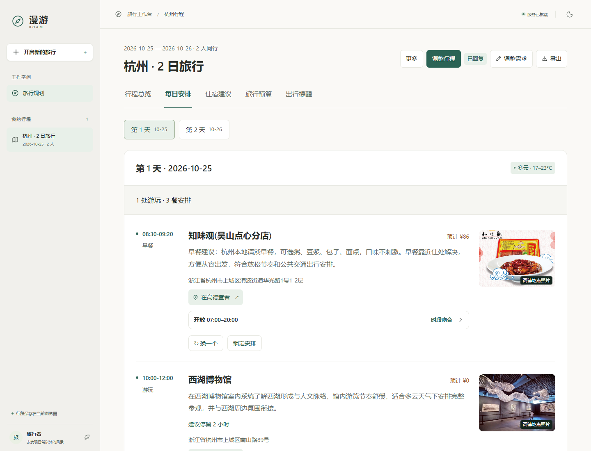

### 4. 住宿建议

查看酒店照片、地址、参考费用和住宿日期，了解每天的落脚点。可从住宿页更换候选或锁定已确定的酒店；同一家酒店的调整会同步关联日期。

酒店费用是按类别与住宿需求预留的估算，不提供实时房态或直接预订。

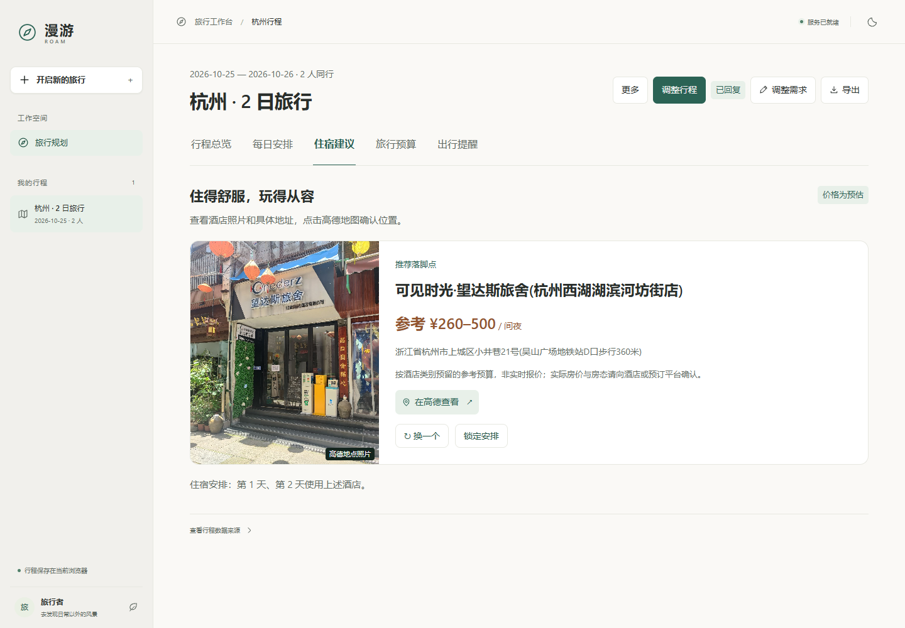

### 5. 预算明细

集中查看总预算、人均费用及各项占比，区分住宿、门票、餐饮、交通和弹性预留。更换地点或对话调整后重新汇总费用，避免总数与每日安排各算一份。

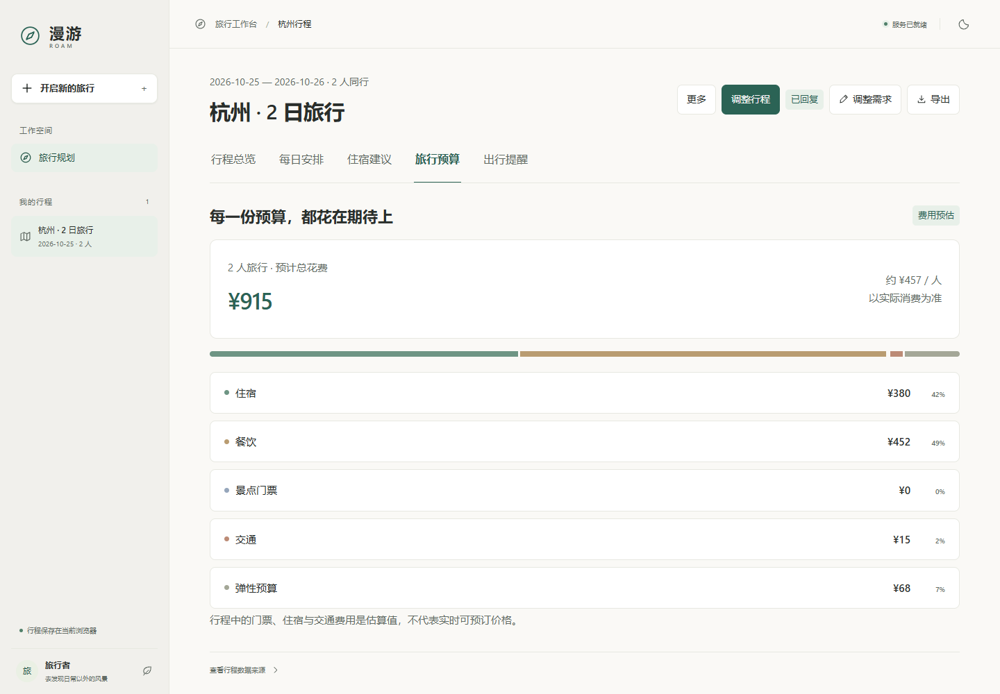

### 6. 基于当前行程的对话

可以询问“哪一项花费最高”“有什么节省建议”，也可以继续提出行程要求。回答结合当前方案与费用，调整结合现有日期、偏好和已生效的规则。

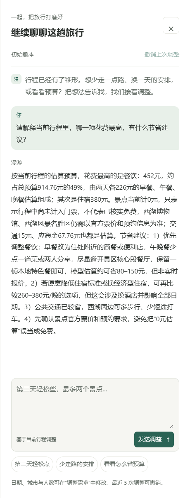

### 7. 局部调整与变化对比

明确指定日期时，优先只重规划对应日期，保留其他日期和锁定安排。界面显示调整前后的变化；新结果完成交通、排程和费用校验后才替换当前方案，失败保留原行程。

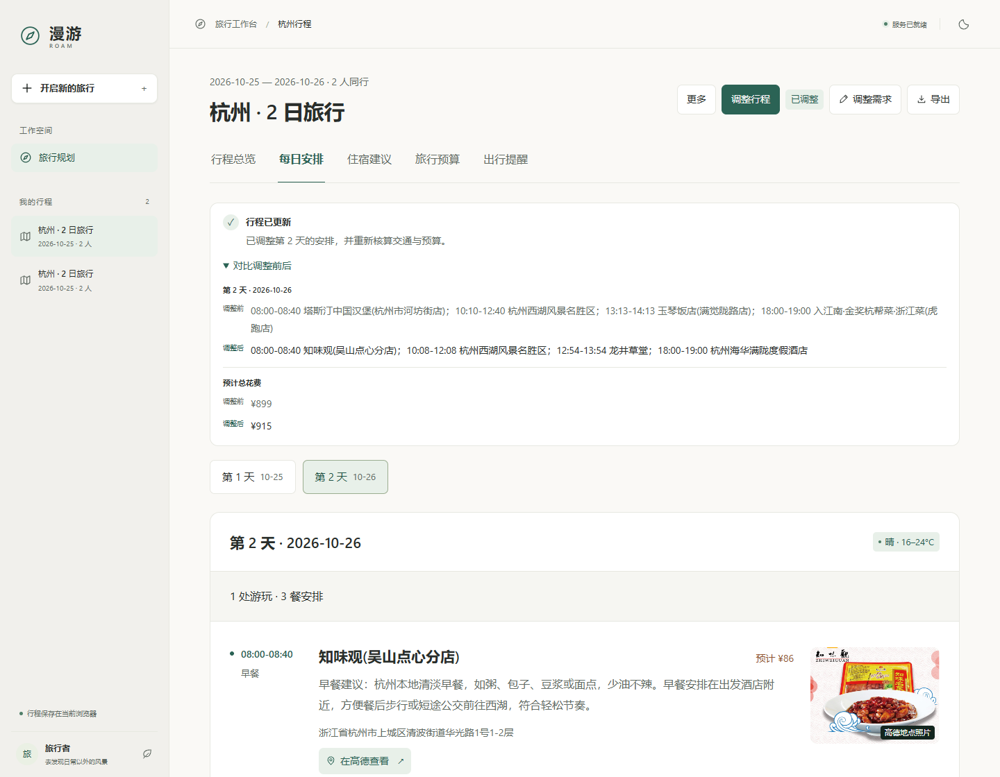

### 8. 锁定已确定的地点

点击“锁定安排”，保留想去的景点、餐厅或酒店。锁定针对地点及所在日期，时间仍可随交通和排程调整；需要更换时先解锁。最近 5 次修改可撤销，包括锁定操作。

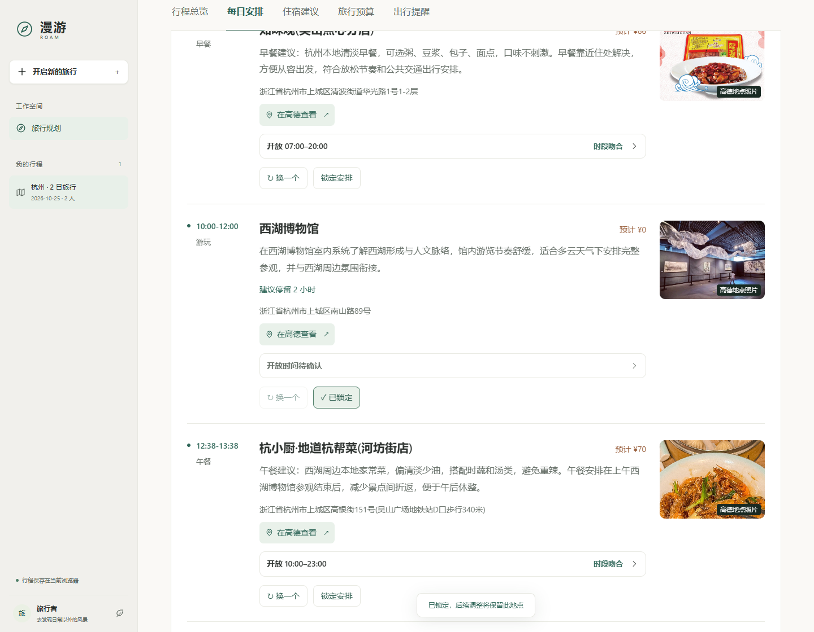

### 9. 从真实候选中替换

点击地点卡片上的“换一个”，先查询候选，再比较地址与参考信息。确认前当前安排保持不变；确认后重新核对受影响的日期、路线和费用，避免直接改名造成资料错配。

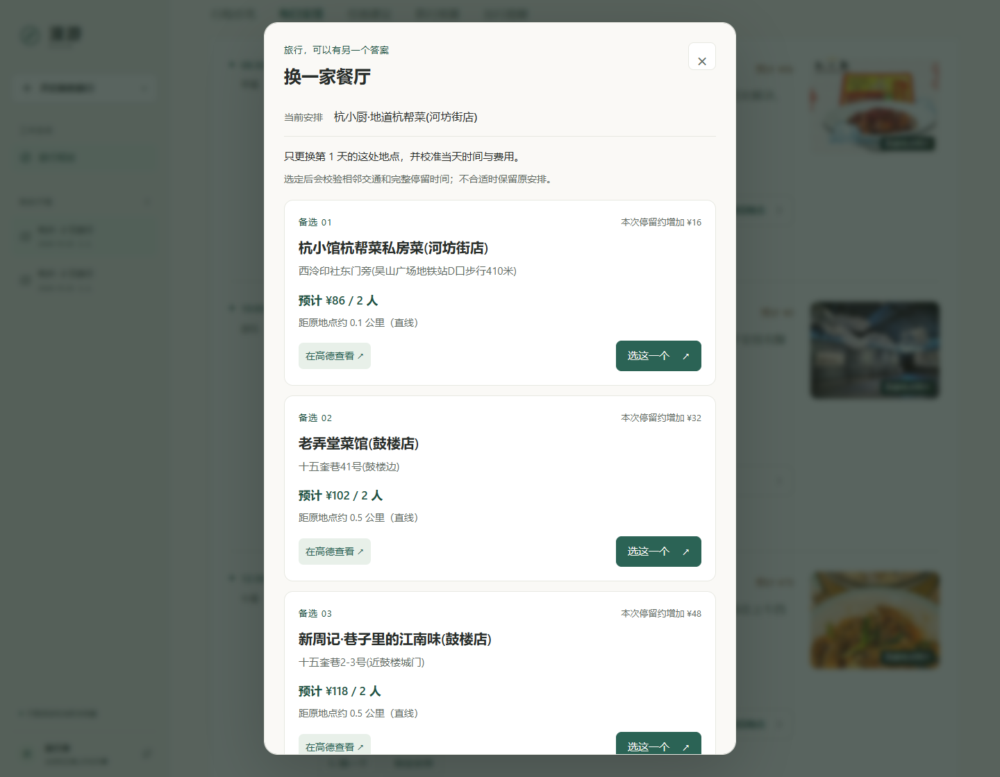

### 10. 行程检查与待确认事项

展开“行程检查”，查看地点坐标、具体餐厅与开放时段的资料情况。已知时间冲突会被拦截；缺失、复杂营业规则与预约等情况保留待确认提示，帮助用户知道出发前还需要核实什么。

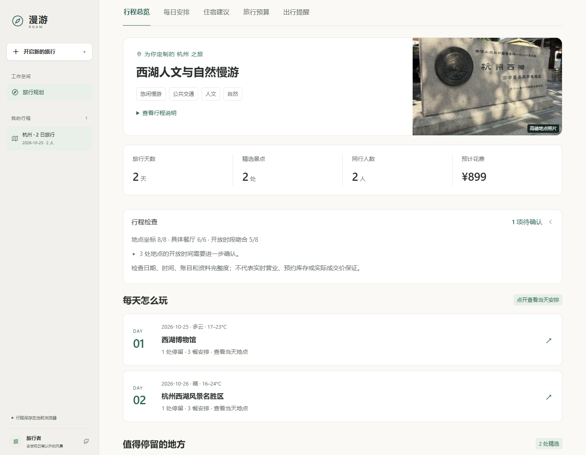

### 11. 导出与备份

“导出”生成 Markdown 旅行计划；更多菜单可备份或导入 JSON。备份包含当前行程、旅行需求、对话、日规则、锁定和地点资料，便于在另一浏览器手动导入继续查看；撤销历史不递归写入备份。

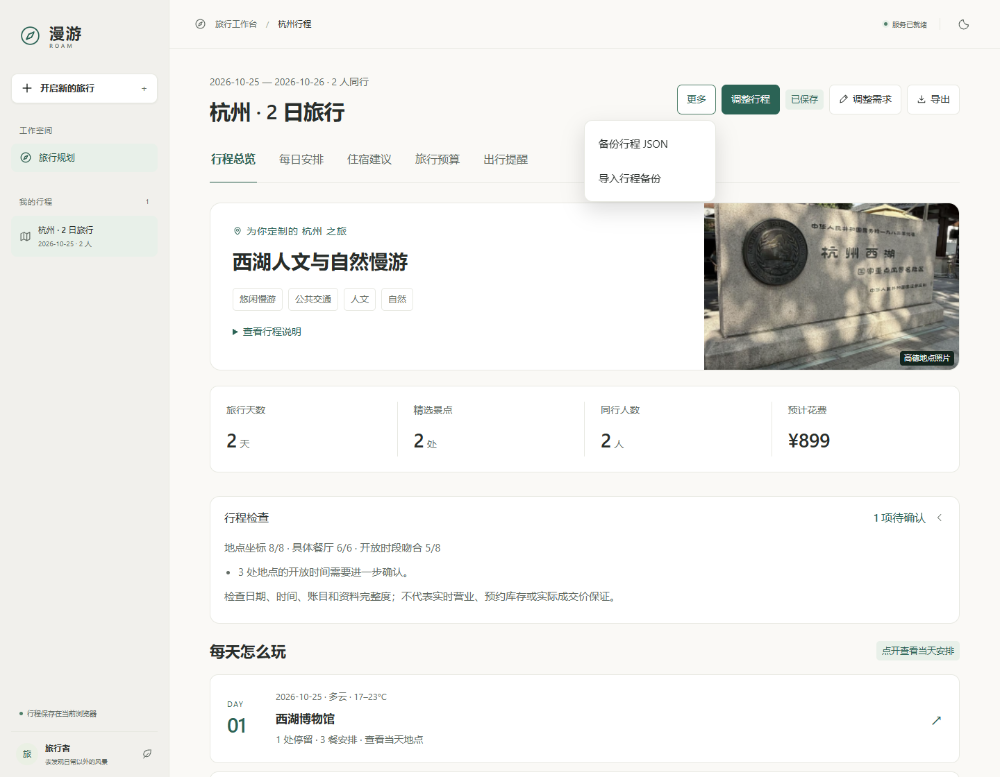

### 12. 后台进度与刷新恢复

生成或调整时展示当前阶段与进度。刷新页面后可继续查看已提交的任务，短暂断线可通过事件重放与快照恢复状态，减少重复提交。SSE 展示任务阶段，不是模型逐 Token 输出。

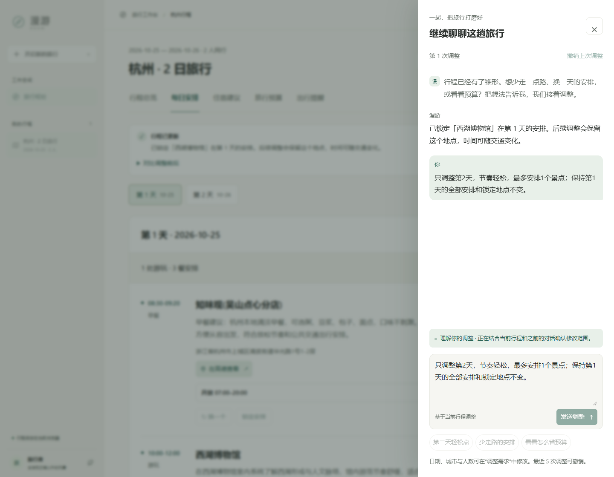

### 13. 移动端与深色主题

桌面与手机共用同一套行程数据，窄屏下调整卡片、导航与对话布局；支持浅色、深色主题切换。

<p align="center">
  <a href="docs/images/showcase-mobile.png">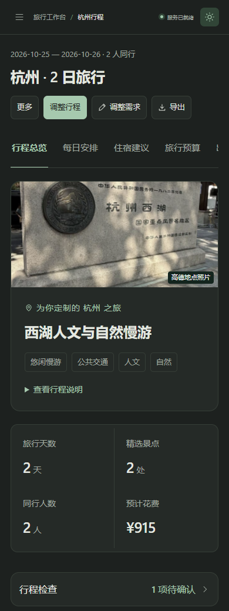</a>
</p>

## 技术栈与架构

| 层次 | 技术与职责 |
| --- | --- |
| Agent 与模型 | **LangChain、Tool Calling**：模型适配、工具 Schema、工具执行循环与专业角色分工；支持 DeepSeek 等 OpenAI 兼容模型接口 |
| 服务接口 | **Python 3.12 / 3.13、FastAPI、Uvicorn**：规划、修改、地点查询、备份导入、后台任务与静态页面服务 |
| 结构与规则 | **Pydantic、确定性业务校验**：需求、候选、行程与修改意图建模，核对地点身份、日期、时间和费用 |
| 外部数据 | **高德 Web 服务、和风天气**：POI、地址、照片、交通、常规营业描述和可查询日期的天气 |
| 任务与通信 | **SQLite、SSE、幂等提交**：任务与事件持久化、阶段推送、事件重放与快照补偿 |
| 前端与存储 | **JavaScript、HTML、CSS、localStorage、sessionStorage**：响应式工作台、本地旅行历史、主题与任务引用 |

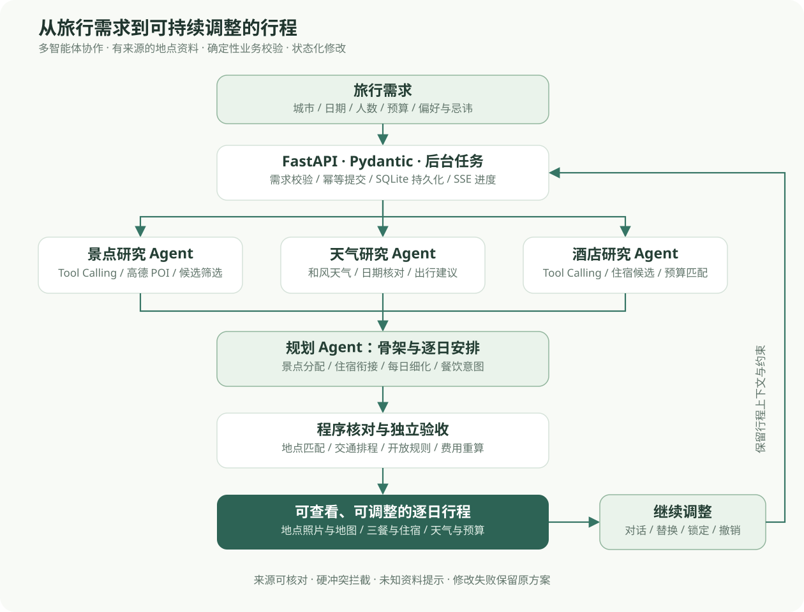

模型负责理解偏好、查询与选择、提出安排；程序负责候选身份、交通和时间约束、费用核算及修改状态。当前 Web 链路使用本地工具注册与 Tool Calling，仓库中的 FastMCP 服务定义为可选扩展。详细职责见 [架构说明](docs/架构与取舍.md)。

## 快速开始

需要 Python 3.12 或 3.13。以下命令以 Windows PowerShell 为例：

```powershell
git clone https://github.com/CB-chubin/roam-travel-agent.git
cd roam-travel-agent
python -m venv .venv
.\.venv\Scripts\python.exe -m pip install -r requirements.txt -c requirements.lock.txt
Copy-Item .env.example .env
.\start-local.ps1
```

浏览器打开 [http://127.0.0.1:8010](http://127.0.0.1:8010)。无 Key 时点击“查看示例行程”体验只读历史示例；完成配置后可生成和调整自己的方案。停止服务使用 `.\stop-local.ps1`。

<details>
<summary>macOS / Linux 启动方式</summary>

```bash
git clone https://github.com/CB-chubin/roam-travel-agent.git
cd roam-travel-agent
python3 -m venv .venv
.venv/bin/python -m pip install -r requirements.txt -c requirements.lock.txt
cp .env.example .env
.venv/bin/python -m uvicorn main:app --host 127.0.0.1 --port 8010 --workers 1
```

</details>

### 配置实时规划

在本地 `.env` 填写以下配置，修改后重启：

| 配置项 | 说明 |
| --- | --- |
| `LLM_ENABLED` | 设置为 `true` 启用模型规划 |
| `LLM_PROVIDER` | 模型提供方标签，例如 `deepseek` |
| `LLM_MODEL` | 支持工具调用的模型名称，例如 `deepseek-chat`；替换后需确认接口兼容性 |
| `LLM_API_KEY` | 模型 API Key |
| `LLM_BASE_URL` | OpenAI 兼容接口地址，例如 `https://api.deepseek.com/v1` |
| `AMAP_API_KEY` | 高德 **Web 服务** Key，用于地点、交通和地点资料查询 |
| `QWEATHER_API_KEY` | 和风天气凭证 |
| `QWEATHER_API_HOST` | 和风控制台分配的专属 API Host，仅填域名 |

凭证由后端读取，`.env`、日志、数据库和个人行程不纳入版本控制。

## 项目结构

```text
src/
  agents/       景点、天气、酒店、规划与对话 Agent
  mcp/          本地工具注册、地图天气适配与可选 MCP 服务定义
  services/     规划、局部编辑、地点资料、任务、排程与验收
  app.py        FastAPI 接口与静态页面服务
  models*.py    结构化业务模型
static/         前端工作台与样式
examples/       无 Key 体验的历史行程示例
docs/           架构说明与功能截图
tests/          自动化回归与固定测试数据
```

## 数据与运行说明

- 当前定位为本地个人旅行工作台，使用单个 Uvicorn worker；后台任务串行执行，单次任务内部的研究及每日细化可并行。
- 地点与交通优先查询高德；本地参考资料、交通估算和未知状态保留来源标识。照片和营业描述可能缺失或过时，复杂开放规则、预约与临时调整需出发前确认。
- 酒店价格、部分门票、餐饮和交通费用为估算，未接入实时库存、订单或支付；当前单日游默认包含一晚住宿，费用展示会说明这一假设。
- 天气只覆盖提供方可查询日期，远期日期不填充虚构温度。
- 刷新或短暂断网可取回同一任务；后端进程重启会明确中断未完成任务，已保存结果仍可恢复。
- 历史行程保存在当前浏览器；JSON 可手动迁移资料，目前没有账号、跨设备自动同步与多人权限。

## 来源

本项目基于 [tuxin-winter/travel_agent](https://github.com/tuxin-winter/travel_agent) 二次开发，学习参考 [Hello Agents](https://github.com/datawhalechina/hello-agents)。来源版本、第三方资料及许可状态见 [NOTICE](NOTICE.md)。
