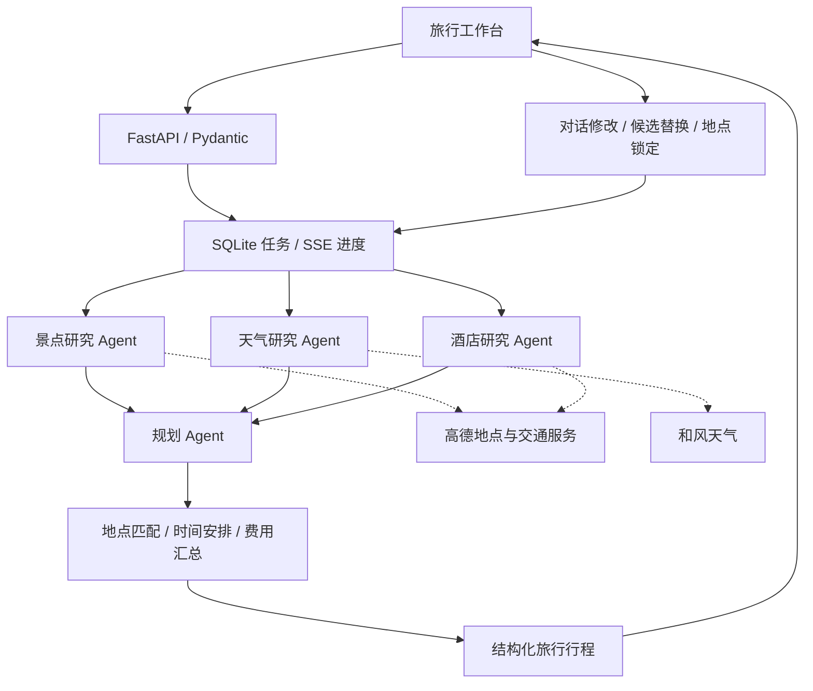

# ROAM 漫游 · 多智能体旅行工作台

面向 **1–7 天国内城市自由行**的 AI 旅行规划应用。填写目的地、日期、预算和偏好，即可获得包含景点、餐饮、住宿与费用的每日安排，并通过对话继续调整。

**多智能体协作 · 真实地点资料 · 对话调整 · 地点锁定 · 预算管理 · 旅行备份**


## 核心功能

| 功能 | 使用方式 |
| --- | --- |
| 个性化旅行规划 | 根据城市、日期、人数、预算、旅行节奏、住宿偏好和出行方式生成安排，支持人文、自然、美食、艺术等偏好 |
| 多智能体协作 | 景点、天气、酒店研究 Agent 并行收集资料，再由规划 Agent 编排每日活动、餐饮和住宿 |
| 真实地点卡片 | 展示高德 POI 的地点照片、具体地址和地图入口，方便查看位置；缺失资料明确提示 |
| 每日行程 | 按日期查看活动时间、景点停留、餐饮与当日住宿，结合交通耗时和可核实的营业时段安排时间 |
| 对话调整 | 用自然语言修改指定日期的安排、减少景点或询问费用，查看调整前后变化，支持最近 5 次撤销 |
| 地点替换与锁定 | 为景点、餐厅、酒店搜索其他候选；锁定需要保留的地点及日期，后续调整继续沿用 |
| 旅行预算 | 展示总费用、人均费用及住宿、餐饮、门票、交通、弹性预算的占比，超出预算时提示 |
| 历史与备份 | 保存本地旅行历史，支持 Markdown 导出、JSON 备份与导入，保留行程、对话和锁定状态 |
| 任务恢复 | 后台执行规划，通过 SSE 展示进度；页面刷新或网络短暂中断后可取回同一任务的结果 |

## 技术栈

| 层次 | 技术与职责 |
| --- | --- |
| Agent 与模型 | **LangChain**：模型适配、工具调用与专业 Agent 分工；支持 DeepSeek 等 OpenAI 兼容模型接口 |
| Web 后端 | **Python 3.12 / 3.13、FastAPI、Uvicorn**：业务 API、后台任务与静态页面服务 |
| 数据模型 | **Pydantic**：旅行需求、候选地点、行程、对话调整和备份的结构化校验 |
| 工具与外部数据 | **本地 MCP 风格工具、高德 Web 服务、和风天气**：地点检索、交通耗时、照片、开放描述与天气查询 |
| 任务与通信 | **SQLite、SSE、幂等提交**：持久化任务、进度推送、事件重放与刷新恢复 |
| 前端 | **原生 JavaScript、HTML、CSS**：响应式工作台、对话抽屉、地点卡片、主题切换 |
| 本地存储 | **localStorage、sessionStorage、JSON / Markdown**：旅行历史、任务引用与导入导出 |

## 系统架构



模型负责理解偏好、搜索与编排，后端负责候选身份、交通耗时、完整停留、三餐窗口、常规营业时间和费用账目。修改在副本上执行，完成校验后再更新当前行程。详细模块与设计说明见 [架构说明](docs/架构与取舍.md)。

## 功能演示

以下截图来自实际运行的杭州两日游页面。照片来自地点资料，费用为规划估算，天气与开放信息以查询时记录为准。点击图片可查看大图。

### 行程总览

集中查看旅行主题、天数、人数、预估费用与每日安排，再进入具体日期查看详情。


### 每日安排与住宿建议

按时间浏览当天活动，直接打开高德地图查看具体地点；住宿页展示酒店照片、地址、参考费用与替换入口。

| 每日安排 | 住宿建议 |
| --- | --- |
| [](docs/images/showcase-itinerary.png) | [](docs/images/showcase-hotels.png) |

### 预算明细

查看总费用与人均花费，按住宿、餐饮、门票、交通和弹性预算了解费用构成。


### 对话调整与移动端

在当前行程上继续提问或调整需求，也可在手机上查看。桌面与移动端均支持浅色、深色主题。

<table>
  <tr>
    <th>基于当前行程的费用问答</th>
    <th>移动端深色界面</th>
  </tr>
  <tr>
    <td align="center" valign="top"><a href="docs/images/showcase-conversation.png"></a></td>
    <td align="center" valign="top"><a href="docs/images/showcase-mobile.png"></a></td>
  </tr>
</table>

## 快速开始

需要 Python 3.12 或 3.13。以下命令以 Windows PowerShell 为例：

```powershell
git clone https://github.com/CB-12345/roam-travel-agent.git
cd roam-travel-agent
python -m venv .venv
.\.venv\Scripts\python.exe -m pip install -r requirements.txt -c requirements.lock.txt
Copy-Item .env.example .env
.\start-local.ps1
```

浏览器打开 **http://127.0.0.1:8010**。未配置 Key 时，首页可点击“查看示例行程”体验只读历史示例；配置完成后可生成和调整自己的行程。停止服务使用 `.\stop-local.ps1`。

<details>
<summary>macOS / Linux 启动方式</summary>

```bash
git clone https://github.com/CB-12345/roam-travel-agent.git
cd roam-travel-agent
python3 -m venv .venv
.venv/bin/python -m pip install -r requirements.txt -c requirements.lock.txt
cp .env.example .env
.venv/bin/python -m uvicorn main:app --host 127.0.0.1 --port 8010 --workers 1
```

</details>

### 配置实时规划

在本地 `.env` 中填写以下配置，修改后重启服务：

| 配置项 | 说明 |
| --- | --- |
| `LLM_ENABLED` | 设置为 `true`，启用模型规划 |
| `LLM_PROVIDER` | 模型提供方标签，例如 `deepseek` |
| `LLM_MODEL` | 提供方支持的模型名称，例如 `deepseek-chat` |
| `LLM_API_KEY` | 模型 API Key |
| `LLM_BASE_URL` | OpenAI 兼容接口地址，例如 `https://api.deepseek.com/v1` |
| `AMAP_API_KEY` | 高德 **Web 服务** Key，用于地点、交通和地点资料查询 |
| `QWEATHER_API_KEY` | 和风天气凭证 |
| `QWEATHER_API_HOST` | 和风控制台分配的专属 API Host，仅填域名 |

Key 仅由后端从本地配置读取，`.env`、日志、数据库和个人行程均被 Git 忽略。当前按本地个人工作台运行，使用单个 Uvicorn worker。

## 项目结构

```text
src/
  agents/       景点、天气、酒店、规划与对话 Agent
  mcp/          工具注册、地图与天气服务适配
  services/     规划、局部编辑、地点资料、任务与排程
  app.py        FastAPI 接口与静态页面服务
  models*.py    结构化业务模型
static/         前端工作台与样式
examples/       无 Key 体验的历史示例
docs/           架构说明与界面截图
```

地点照片、地址与开放描述来自第三方资料；缺失或复杂规则会提示确认。酒店价格和行程费用为估算，票务、预约、实时库存与支付由用户自行确认。

## 来源

本项目基于 [tuxin-winter/travel_agent](https://github.com/tuxin-winter/travel_agent) 二次开发，学习参考 [Hello Agents](https://github.com/datawhalechina/hello-agents)。来源版本、第三方资料及许可状态见 [NOTICE](NOTICE.md)。
