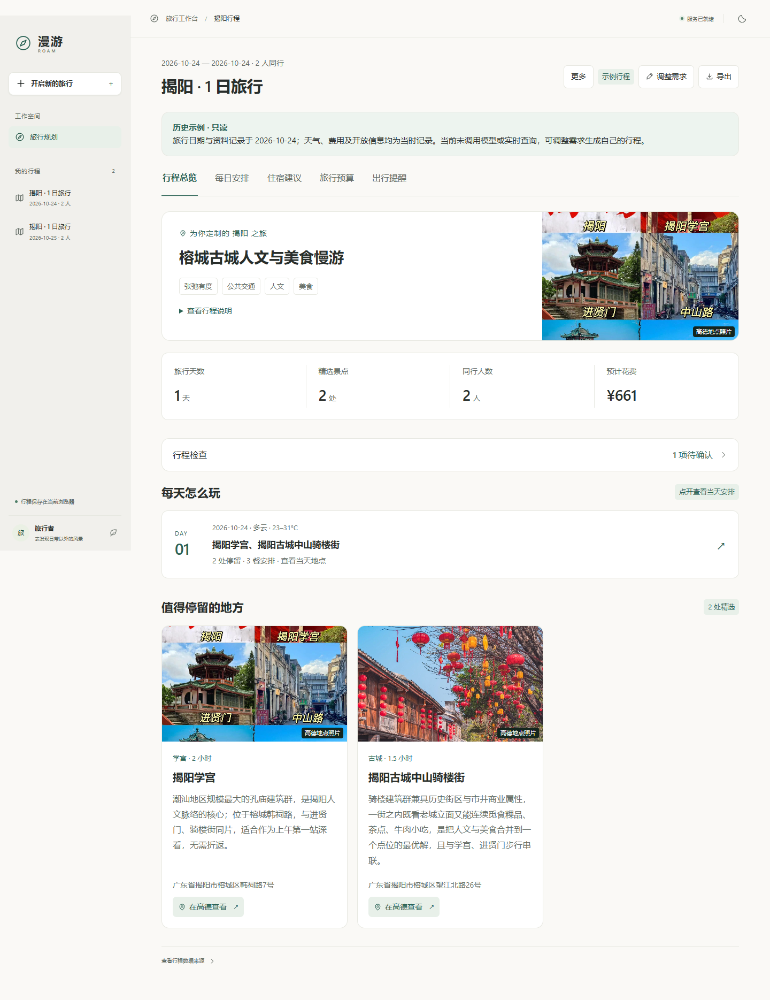

# ROAM 漫游 · 多智能体旅行工作台

[](https://github.com/CB-12345/roam-travel-agent/actions/workflows/ci.yml)

面向 1–7 天国内城市自由行：从需求出发生成可查看、可局部修改、可撤销的旅行安排。模型负责研究与编排，后端核对地点、时间、常规开放规则和费用账目。界面提供照片、具体地址与高德入口，默认折叠技术记录。

本项目基于 [tuxin-winter/travel_agent](https://github.com/tuxin-winter/travel_agent) 二次开发（原 zhengzhi-zy 地址会重定向），学习背景来自 [Hello Agents](https://github.com/datawhalechina/hello-agents)。上游已包含研究 Agent、候选检索、结构化规划、餐饮和交通链路；本地改造重点是交互、对话与地点编辑、时空及账目一致性、任务可靠性和可复现验证。直接上游未明确再分发许可，公开发布前应核实授权；具体来源、版本和许可状态见 [NOTICE](NOTICE.md)。



[手机深色界面](docs/images/demo-mobile-dark.png) · 截图中的照片来自实际 POI 资料，示例日期已明确标注。

## 快速体验

已安装环境可运行：

```powershell
.\start-local.ps1
# 停止：.\stop-local.ps1
```

浏览器打开 **http://127.0.0.1:8010**，点击“查看示例行程”。示例无需 Key，不调用模型或地图/天气查询，来自 2026-10-24 的真实录制行程，明确标注历史数据与只读状态。图片仍来自第三方 URL，离线可能无法加载。示例支持地图链接、预算、检查详情及导出；要调整行程请生成自己的版本。

## 首次安装

本机验证环境为 Windows、Python 3.13.5、Node.js。已用不含本地配置/数据的源码副本与全新虚拟环境完成安装、回归和无 Key 示例服务验收，详见 [验证记录](docs/验证记录.md)。CI 配置覆盖 Ubuntu Python 3.12/3.13，实际远端状态以 GitHub Actions 为准。

```powershell
git clone https://github.com/CB-12345/roam-travel-agent.git
cd roam-travel-agent
python -m venv .venv
.\.venv\Scripts\python.exe -m pip install -r requirements-dev.txt -c requirements.lock.txt
Copy-Item .env.example .env
.\start-local.ps1
```

也可直接运行单 worker：

```powershell
.\.venv\Scripts\python.exe -m uvicorn main:app --host 127.0.0.1 --port 8010 --workers 1
```

`requirements.lock.txt` 是已验证环境的解析版本快照，含 Windows 依赖平台标记。安装时将它作为约束，避免无意升级依赖。不要把 `.env`、本地运行数据库、日志或个人行程提交到仓库。

## 实时规划配置

在本地 `.env` 填写，前端不收集或保存 Key：

| 配置 | 用途 |
| --- | --- |
| `LLM_ENABLED=true` | 启用真实模型规划 |
| `LLM_PROVIDER` | 提供方标签，例如 deepseek |
| `LLM_MODEL` | 提供方支持的模型名 |
| `LLM_API_KEY` | 模型凭证 |
| `LLM_BASE_URL` | 兼容 OpenAI 的接口地址，按厂商填写 |
| `AMAP_API_KEY` | 高德 Web 服务 Key，检索地点、交通、照片和开放描述 |
| `QWEATHER_API_KEY` | 和风天气凭证 |
| `QWEATHER_API_HOST` | 和风控制台专属 API Host，仅域名，不含路径 |
| `LLM_TIMEOUT_SECONDS` | 单次模型请求超时，默认 60 秒 |

修改后先停止，再启动。超出天气可预报日期时提示缺失，开放信息复杂时保留“待确认”。缺少 Key 时可看录制示例；系统兼容的本地回退数据只用于开发，不能当成真实可出行资料。

## 已实现的业务闭环

- 景点、天气、酒店研究 Agent 并行检索，规划 Agent 生成住宿骨架和每日安排；实体来自候选工具数据。
- 真实 POI 身份匹配、照片、具体地址和高德链接；同名歧义与未知资料明确标记。
- 交通耗时与到达缓冲、完整游玩时长、正常三餐窗口、可解析的常规开放规则共同约束排程。页面只展示地点和地址，交通链用于后台核算。
- 指定日期对话调整、费用问答、候选替换、地点锁定、前后对比和最近五次撤销；修改失败保留原版本。
- 预算按实际安排、收费晚数、每间两人的房间数重新汇总；参考费用不代表成交价，无酒店预订及支付功能。
- 独立规则验收：明确错误阻止新结果提交，未知天气/营业/坐标等提示确认；旧行程补充检查不静默重排。
- SQLite 持久任务、提交幂等、有界队列、有序 SSE 事件重放与快照补偿；刷新后取回同一任务。服务重启会明确中断未完成任务，完成结果保留 24 小时且最多 200 项。
- 本地历史最多 12 份，JSON 备份可导入为新行程；包含当前计划、对话、每日限制、锁定和地点资料，不递归保存撤销历史。Markdown 导出便于阅读。
- 可折叠运行统计包含模型/工具/HTTP 调用次数、耗时及提供方实际报告的 Token。统计不记录提示词或 Key；任务库保存恢复所需的需求和结果。

## 验证

下列回归与离线评测无需真实 API Key，不消耗模型请求。真实接口验证另行显式执行，不纳入离线 CI。

```powershell
.\.venv\Scripts\python.exe -X utf8 -m pytest -q tests
.\.venv\Scripts\python.exe -X utf8 scripts/evaluate.py --output evals/latest-report.json
node --test tests/frontend/*.test.cjs
node --check static/app.js
node --check static/task-client.js
node --check static/portfolio.js
```

本轮本地结果：**144 项 Python 测试、7 项前端任务恢复测试通过，20/20 个离线质量案例符合预期**。案例覆盖时间重叠、完整停留、交通缓冲、开放冲突、餐厅营业时段预筛选、未知信息、候选一致性、三餐、天气、住宿与预算；[评测记录](evals/latest-report.json) 可复跑。

这 20 项使用同一份录制行程与确定性故障注入，衡量规则回归，**不代表模型规划准确率、跨城市成功率或线上可用率**。端到端真实生成的验证单独记录，不和离线规则检出混为同一个指标。CI 在 push/PR 时运行测试、评测及 JavaScript 语法检查。

[单次真实生成记录](evals/live-smoke-report.json)：2026-10-24 测试揭阳一日规划，后台耗时 95.74 秒，模型调用 11 次、工具调用 12 次、HTTP 调用 44 次；11 次模型调用均有用量报告，共 50,051 输入 Token 和 11,326 输出 Token。浏览器在规划中刷新后取回同一任务，最终规则验收通过。这是单次观测，不能代表平均性能、成本或成功率；统计不包含结果页随后补充的地点资料查询。

浏览器验收也验证了费用问答、锁定、备份保留上下文、文件导入、示例无实时查询，以及 390px 手机深色布局无横向溢出。最终结果页的桌面浅色与手机深色自动可访问性检查均为 0 项违规、0 项待人工判定；这不等于完成了全应用人工无障碍评估。

## 真实接口回归（按需执行）

先启动已配置模型、高德与和风的服务，再运行：

```powershell
.\.venv\Scripts\python.exe -X utf8 scripts/live_smoke.py
```

这条命令会消耗当前服务的 API 额度，依次执行 `evals/live-cases.json` 的四组请求，并检查杭州行程的局部修改与锁定。日期按运行当天计算；提供方数据和模型输出会变化，失败案例也写入报告。完整任务快照仅保留在被忽略的 `data/local-runtime/live-smoke/`，公开摘要不含 Key 或原始模型响应。

实时样例与干净环境复现的实测结果见 [验证记录](docs/验证记录.md)。这些是少量场景的工程验收，不能当成全国城市规划成功率。

本轮四城首测 3/4 通过；杭州早餐门店营业冲突被拦截，修正后真实生成与指定日期修改复测均通过。保留 [首轮报告](evals/live-matrix-initial-report.json) 与 [修复复测](evals/live-recheck-report.json)，不覆盖失败记录。

## 准备提交源码

项目作为独立 Git 仓库维护，`.gitignore` 排除本地环境、Key、日志、数据库和个人行程。提交前暂存源码，再检查实际暂存内容：

```powershell
git add .
.\.venv\Scripts\python.exe -X utf8 scripts/check_release.py
git diff --cached --stat
```

检查包含私有/生成文件、已配置凭证是否意外混入、必需文件和文档相对链接；通过只表示技术检查通过，不能替代 [上游授权核实](NOTICE.md)。请保留来源与修改声明。

## Docker 本地运行

```powershell
docker build -t roam-travel:local .
# 无 Key 示例
docker run --rm -p 127.0.0.1:8011:8010 -v roam-tasks:/app/data roam-travel:local
# 真实规划时另加 --env-file .env
```

打开 http://127.0.0.1:8011 。挂载卷保留任务库，浏览器行程仍保存在浏览器本地。只运行单 worker。镜像构建上下文采用白名单，不包含 `.env`、数据库和日志。默认本地个人使用；此版本未实现多人账号与任务归属隔离。

本次 Docker 实际构建在拉取 `python:3.13-slim` 时遇到 Docker Hub 认证服务连接超时，未完成容器启动验证；本地 Python 运行已验证。请在可访问 Docker Hub 的网络中重试上述命令。

## 代码入口

| 位置 | 职责 |
| --- | --- |
| `src/agents/`、`src/llm.py` | 研究/规划 Agent 与 LangChain 模型、工具调用 |
| `src/services/planner.py` | 候选、排程、餐饮、交通、费用主流程 |
| `src/services/revision.py`、`place_edits.py`、`stop_locks.py` | 对话修改、精细替换与锁定 |
| `src/services/planning_quality.py`、`opening_hours.py` | 确定性排程与常规开放规则 |
| `src/services/quality.py` | 独立最终结果验收 |
| `src/services/tasks.py`、`observability.py`、`errors.py` | 持久任务、安全统计与错误处理 |
| `src/services/places.py` | 地点匹配、照片和资料缓存 |
| `src/mcp/` | MCP 风格工具注册、地图与天气数据适配 |
| `src/app.py` | API、SSE 和本地静态页面 |
| `static/` | ROAM 工作台、地点与对话编辑、任务恢复、备份及示例 |
| `examples/`、`evals/`、`scripts/evaluate.py` | 录制示例与离线回归评测 |

[架构与取舍](docs/架构与取舍.md) 包含规划链路、模型与规则边界、可靠性及并发限制；[简历与演示](docs/简历与演示.md) 包含贡献写法、演示步骤和面试问答。

当前 Web 主流程使用 LangChain 与本地 MCP 风格工具，并非分布式 MCP 服务或 LangGraph 工作流。未接入真实票务、预约库存、酒店成交价与支付；节假日例外和复杂开放规则需要人工确认。要扩展多人服务，应先增加身份与任务归属、限额、独立请求上下文及共享调度。
