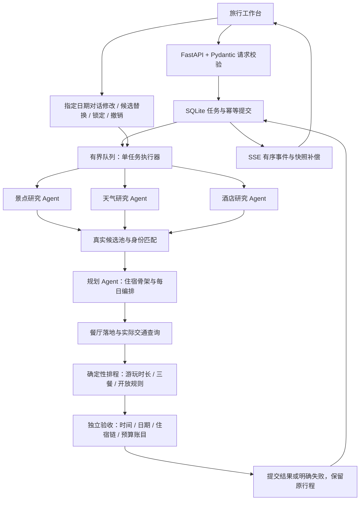

# 架构与取舍

## 规划链路

三类研究通过线程池并行执行，使用 `copy_context()` 传递同一个线程安全的运行记录器；骨架和每日安排有先后依赖。这里的“多智能体”是专业分工及工具调用，并非无限自主协商。底层使用 LangChain 的模型适配和本地 MCP 风格工具注册；仓库虽包含 MCP 服务模块，当前 Web 主链路并没有部署独立的分布式 MCP 集群，也没有迁移到 LangGraph。

## 模型与规则的边界

模型解释偏好、搜索、选择候选及提出安排。后端负责候选身份、完整停留时长、真实交通与缓冲、用餐窗口、可解析的常规开放时段和费用汇总。独立 `quality.py` 重新读取最终结果进行验收，不复用模型的自评分。

餐厅候选先按实际出行日筛选常规营业时段与正常用餐窗口，避免把午餐店选作早餐店；每餐最多核对 8 个不同候选，复用地点缓存。未知规则不猜测，没有合适门店时保留区域建议。该筛选只排除已知不可用项，最终排程仍结合交通、前序活动和完整时长再校验一次。锁定餐厅不被静默替换，冲突需用户调整。

硬错误包括时间重叠、开放冲突、景点总览与每日安排不符、预算加总或账目不符、住宿日期链错误。未知坐标、无法解析的开放例外、天气缺失、区域餐饮建议、超预算会产生待确认项。通过规则检查不等于有预约、车票、实时库存或成交价保证。

修改在副本上执行。完成重排及验收后前端才替换当前版本，失败保留原行程；最近五次完整快照支持撤销。锁定保留地点与所在日期，时间仍可随交通调整。同酒店替换同步全部使用日期。卡片和导出只呈现地址与高德入口，后台交通链用于可行性和费用计算。

## 任务恢复与并发

`tasks.py` 持久化请求、状态、序号事件、结果与运行统计。结果和终态事件在一个 SQLite 事务中落盘。SSE 消费不会删除结果，支持 `Last-Event-ID` 和 `after` 游标。浏览器保存任务引用，刷新后用快照恢复；网络断开先重连，必要时轮询快照。

提交使用 `Idempotency-Key`；相同标识和请求返回原任务，内容不同返回 409。网络丢失初始响应时可用提交标识查询。运行中与排队中合计最多 4 项，第 5 项返回 429，尚未调用模型。并发提交去重在锁内完成。

规划器含可变候选上下文，因此任务串行执行，每个任务内部的三类研究仍并行。地图请求间隔用独立锁保护。地点资料有自己的锁和有效期，不必等待整个规划结束。此设计适合本地个人工作台；运行 `uvicorn --workers 1`，不要把 SQLite 任务库挂给多个独立 worker。

进程重启后不尝试从某次模型调用中间恢复，而是将未完成任务标记为 `server_restarted` 并给出重试说明；已完成结果仍可恢复。终态结果保留 24 小时，最多 200 项；浏览器历史最多 12 份。刷新恢复依赖同一标签页的 sessionStorage；跨设备恢复、登录权限和分布式调度未实现。

## 数据与可观测性

高德提供 POI、照片、坐标、交通及常规开放描述，和风天气提供可查询日期的天气。唯一匹配失败时显示待确认或地图搜索，不编造门店和图片。酒店价格及部分费用为估算，无预订与支付链路。复杂节假日、预约、跨夜规则按未知处理。

运行统计记录模型、工具、HTTP 次数与耗时，以及提供方实际返回的 Token；缺失用量不推算为真实零消耗。并行调用耗时不能相加当作总时长。记录器不保存提示词、工具参数、原始响应或 Key；任务库另行保存恢复所需的行程需求与结果，属于本地用户数据。原始异常经 `errors.py` 转成安全提示。

## 验证与后续扩展

测试覆盖排程、开放规则、地点身份、局部编辑、回滚、任务重放与持久化。`scripts/evaluate.py` 使用一份真实录制行程和可解释的故障注入，衡量规则检出回归；它无法代表模型跨城市规划成功率。CI 配置会在提交后运行，配置本身不代表 GitHub 上已经通过。

若要多人线上服务，首先增加身份与任务归属、限额、服务端行程版本控制，再拆分无状态规划上下文与任务队列；应先用更多城市、日期和需求建立真实评测集，再讨论吞吐或框架迁移。
