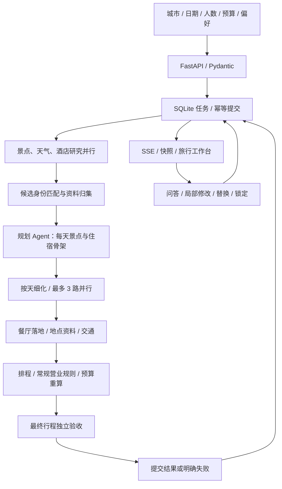

# 架构与模块职责

ROAM 采用受控的多智能体工作流，将外部数据查询、模型规划、确定性校验与行程状态管理分开。

## 规划流程

## Agent 与工具

| 模块 | 职责 |
| --- | --- |
| `agents/attraction_agent.py` | 结合偏好与忌讳选择搜索词，从候选池筛选景点 |
| `agents/weather_agent.py` | 生成天气相关出行建议；天气事实由程序取提供方结果并补回 |
| `agents/hotel_agent.py` | 结合人数、预算、晚数和住宿要求选择酒店 |
| `agents/itinerary_agent.py` | 先生成每天景点与住宿分配，再细化每日安排与餐饮意图 |
| `agents/revision_agent.py` | 区分问答、澄清和修改，提取修改日期、日规则及候选选择 |
| `llm.py` | 模型适配、工具 Schema 绑定、工具执行循环、JSON 提取与有限纠正 |
| `mcp/travel_backend.py` | 地图与天气数据适配、缓存、请求间隔、交通查询与来源标识 |
| `mcp/travel_tool.py`、`mcp/tooling.py` | 将业务函数注册为模型可调用的本地工具 |

多个角色可共享同一模型服务，通过职责、提示词和工具权限分工。当前 Web 主流程使用 LangChain 模型适配与本地 Tool Calling；`mcp/travel_server.py` 提供可选 FastMCP 服务定义，尚未作为网页主链路的协议连接层。

## 模型与规则的分工

模型负责理解偏好、提出查询、选择候选和编排建议。程序负责把输出关联回有来源的地点，再检查日期、时长、交通、开放窗口及账目。

- **结构约束**：Pydantic 检查需求、研究结果、行程、修改意图与备份字段。
- **候选约束**：模型选择的景点与酒店必须匹配本轮候选，地址和坐标从原始资料补回。
- **排程约束**：保留完整活动时长，计入交通与到达缓冲，结合用餐窗口与可解析的营业规则调整。
- **费用核算**：按每日实际安排与收费住宿晚数重新汇总，明确房间数量、估价与弹性预算假设。
- **独立验收**：`quality.py` 重新读取最终方案检查，不依赖模型自评分。

时间冲突、已知开放冲突、住宿链与账目不一致等硬错误会被拒绝；天气、复杂开放规则、缺失坐标、区域餐饮建议与超预算等情况保留待确认提示。规则通过不代表实时库存、预约或成交价保证。

## 行程修改与状态

对话修改会结合当前行程、有限历史和已生效日规则确定作用范围。指定日期调整保留其他日期；全局预算、交通、住宿等变化可能影响所有日期。

修改先在深复制的方案上执行，完成候选、排程、费用及锁定校验后再更新前端；失败保留原版本。锁定保留地点及所在日期，时间仍可随排程变化。同一家酒店替换时同步全部关联日期。

浏览器保存最近 5 次修改快照用于撤销。JSON 备份包含需求、行程、对话、日规则、锁定与地点资料，不递归包含撤销历史；Markdown 提供便于阅读和携带的行程文本。

## 任务与 SSE

`tasks.py` 在 SQLite 保存任务需求、状态、序号事件、结果及运行统计。结果和终态事件在同一事务中提交。

- 提交使用 `Idempotency-Key`，同键同内容返回原任务，同键不同内容返回冲突。
- 运行与排队合计容量为 4；任务由单执行线程串行处理，避免共享规划上下文串数据。
- SSE 支持 `Last-Event-ID` 与 `after` 游标，页面重连可重放事件，必要时查询任务快照。
- SSE 展示规划阶段，不是模型逐 Token 流；前端连接断开不等于后台任务取消。
- 进程重启时未完成任务明确失败，已完成结果仍可恢复，不提供模型调用内部断点续跑。

终态结果默认保留 24 小时、最多 200 项；浏览器历史最多 12 份。任务引用通过当前标签页的 sessionStorage 保存，行程历史通过 localStorage 保存。

## 展示与资料来源

地点详情按 POI 身份、名称、地址与位置核对，唯一匹配失败时保留待确认或地图搜索入口，不强行展示精确坐标。地点事实缓存与某一天的开放判断分开，访问时段变化后重新检查。

页面集中展示具体地址与高德入口，交通链在后台参与可行性和费用计算。高德与和风资料可能缺失或过时；酒店与部分费用为估算，系统不包含真实预订、支付和出票。

## 运行边界

当前适合本地个人工作台，使用单个 Uvicorn worker。多人服务需要增加身份与任务归属、用量限额、服务端版本管理、独立请求上下文与共享调度，再考虑多个执行器。

模型、工具和网络接口都可能超时或失败，程序通过有限纠正、配额、来源标记和安全错误提示管理边界；仍需避免将缺失资料解释为已核实事实。
